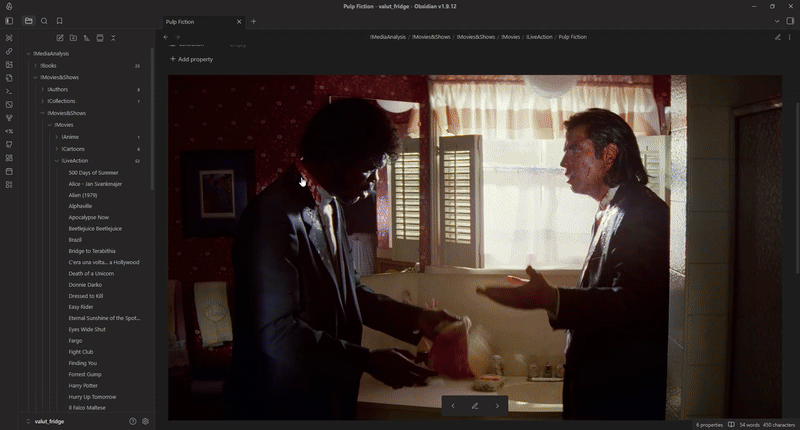
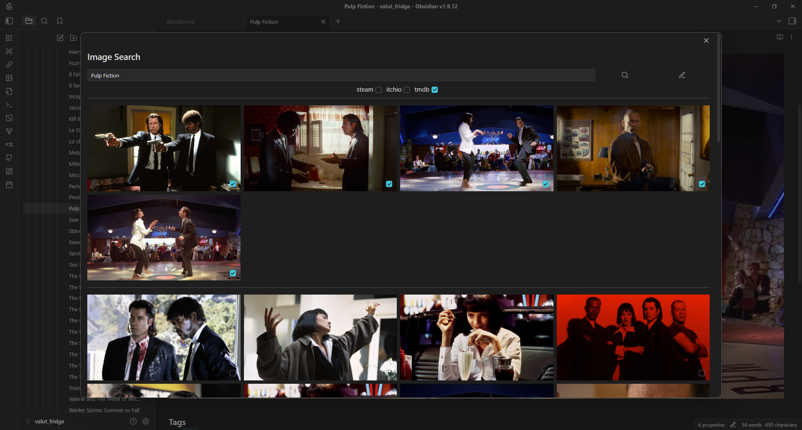
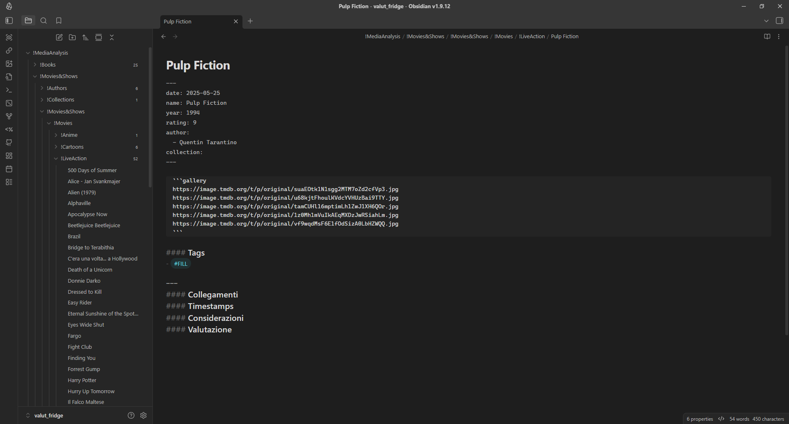
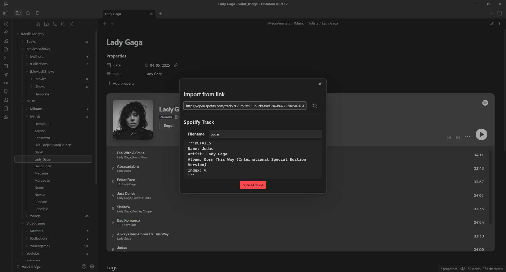

# Obsidian Tools (TsKx)

## Intro
Estensione Obsidian per la gestione del mio archivio media personale: musica, film, videogiochi, anime e libri.

Il plugin si occupa esclusivamente di:
- **gallery**: code block `gallery` con carousel e modale di ricerca immagini;
- **crawler**: ricerca di banner e copertine da Steam, itch.io e TMDb;
- **import automatici** specifici della forma del mio vault (al momento Spotify: tracce, album e artisti);
- **embed**: conversione dei link ai media in iframe nelle note.

Le feature di template e lo scanner sono state separate in un plugin dedicato e non fanno più parte di questa repository.

### Gallery e Image Scraper

Il code block `gallery` raccoglie una lista di URL (uno per riga) e, in modalità lettura, li mostra come carousel con frecce e menu contestuale.



La modale **Image Search** permette di cercare immagini da una o più fonti e di selezionarle tramite checkbox. Le immagini già presenti nella gallery sono mostrate per prime e possono essere deselezionate per rimuoverle.



Il risultato viene scritto nel code block `gallery` della nota attiva, oppure copiato negli appunti se non c'è una gallery di destinazione.



### Import From Link

Gli import automatici sfruttano l'API di Spotify. Incollando il link di una traccia, di un album o di un artista vengono recuperate le informazioni e viene creato un nuovo documento nella cartella corretta del vault, partendo dal relativo `!Template.md`.



I percorsi di destinazione e i template sono volutamente hardcoded: sono specifici della struttura del mio vault.

### Embed

Il post processor converte automaticamente i link a Spotify, YouTube, Steam e itch.io in iframe nelle note, mantenendo il layout coerente con il tema di Obsidian.

## Cmd
```cli
npm run dev
```

Build di produzione e typecheck:

```cli
npm run build
```
